# IIIT Vadodara Campus Portal

Modern, accessible, unified campus portal for the Indian Institute of Information Technology Vadodara (IIITV). Built with **Vaadin Flow 24.5.4 LTS**, **Spring Boot 3.3.5**, and **Java 21**.

---

## Table of Contents
- [Architecture & Tech Stack](#architecture--tech-stack)
- [UI Architecture & Design System](#ui)
  - [Theme Tokens](#theme-tokens)
  - [Component Catalog](#component-catalog)
  - [Switching from MockApiClient to Real ApiClient](#switching-from-mockapiclient-to-real-apiclient)
  - [Screenshots](#screenshots)
- [Testing](#testing)
  - [Karibu-Testing Unit Test Suite](#karibu-testing-unit-tests)
  - [Playwright Smoke Test Suite](#playwright-smoke-tests)
- [Running the Application](#running-the-application)

---

## Architecture & Tech Stack

- **Framework**: Vaadin Flow 24.5.4 LTS (Server-side Java component tree with web component rendering)
- **Runtime**: Spring Boot 3.3.5, Java 21 (Amazon Corretto / OpenJDK)
- **CSS Architecture**: Strictly scoped external CSS (`src/main/resources/META-INF/resources/frontend/styles.css`). Zero inline styles (`getStyle().set()` prohibited).
- **Compliance**: WCAG AA Accessible (contrast $\ge 4.5:1$, visible focus rings, aria labels, `prefers-reduced-motion` and `@media print` support).

---

## UI

### Theme Tokens

All styling adheres to semantic CSS custom properties defined in `styles.css`. No emojis, gradients, or arbitrary ad-hoc hex values are used.

| Category | CSS Variable | Hex / Value | Semantic Role / Contrast Ratio |
|---|---|---|---|
| **Primary Navy** | `--campus-navy` | `#12306B` | App header, primary headings, high-emphasis text. WCAG AAA ($12.8:1$). |
| **Secondary Blue** | `--campus-blue` | `#1F4FA8` | Primary action buttons, active indicators, interactive links ($7.2:1$). |
| **Active Nav** | `--campus-nav-active` | `#3A63B8` | Sidebar navigation active item highlight. |
| **Hover Navy** | `--campus-navy-hover` | `#0D224D` | Hover and focus state for primary interactive elements. |
| **Page Background** | `--campus-bg` | `#F2F5FA` | Light blue-gray app background. |
| **Card Surface** | `--campus-card-bg` | `#FFFFFF` | Elevated surfaces, cards, modals, dialogs. |
| **Border / Divider** | `--campus-border` | `#DDE3EE` | Hairline borders (1px solid), table row dividers. |
| **Primary Text** | `--campus-text-main` | `#14213D` | Body text, titles, data tables. Contrast on card surface: $13.5:1$ (AAA). |
| **Muted Text** | `--campus-text-muted` | `#5A6577` | Captions, timestamps, secondary labels. Contrast on card surface: $5.8:1$ (AA). |
| **Status: SAFE** | `--badge-safe-bg` / `--badge-safe-fg` | `#D1FAE5` / `#065F46` | Attendance $\ge 75\%$, on-track metrics, active enrollments ($7.4:1$). |
| **Status: WATCH** | `--badge-watch-bg` / `--badge-watch-fg`| `#FEF3C7` / `#92400E` | Attendance $70\%-74\%$, imminent deadlines ($6.8:1$). |
| **Status: SHORT** | `--badge-short-bg` / `--badge-short-fg`| `#FEE2E2` / `#991B1B` | Attendance $< 70\%$, critical shortage ($7.9:1$). |
| **Accent Orange** | `--campus-accent-orange` | `#F28C28` | Key visual accents, urgent alerts, actionable highlights ($4.6:1$). |
| **Font Family: UI**| `--font-ui` | `'Source Sans 3', sans-serif` | All navigational elements, body copy, headings. |
| **Font Family: Mono**| `--font-mono` | `'IBM Plex Mono', monospace` | Roll numbers, course codes, percentages, timestamps, stats. |
| **Border Radius** | `--radius-card` / `--radius-btn` | `8px` / `6px` | Standardized card border radius and button radius. |

---

### Component Catalog

The UI is built with a modular component library located in `src/main/java/com/iiitv/campus/ui/components/`:

| Component | Class | Purpose & Behavioral Highlights |
|---|---|---|
| **PageHeader** | `PageHeader.java` | Standardized header with title, subtitle, breadcrumbs, and optional right-aligned search bar or action buttons. |
| **StatusChip** | `StatusChip.java` | Compact semantic status indicator (`SAFE`, `WATCH`, `SHORT`, `NEUTRAL`) rendered with mono font and high-contrast tokens. |
| **StatCard** | `StatCard.java` | Metric presentation card displaying title, big numeric/percentage metric in mono font, trend indicator, and helper text. |
| **AttendanceRing**| `AttendanceRing.java`| Circular SVG-based attendance gauge with percentage center text, color-coded based on the $75\%$ statutory threshold. |
| **ScheduleRow** | `ScheduleRow.java` | Compact timeline item showing start/end time, subject code, room number, faculty name, and attendance status. |
| **CardSection** | `CardSection.java` | Clean container card with header, optional action buttons, and responsive inner padding. |
| **EmptyState** | `EmptyState.java` | Standardized empty state graphic and message when zero data is returned (e.g., zero pending tasks or no search matches). |
| **SkeletonBlock** | `SkeletonBlock.java` | Accessible loading skeleton blocks with subtle pulse animation honoring `prefers-reduced-motion`. |
| **SearchDialog** | `SearchDialog.java` | Keyboard-accessible modal search dialog (`Cmd+K` / `Ctrl+K`) with instant search across courses, people, and rooms. |
| **JoinClassroomDialog**| `JoinClassroomDialog.java` | Modal form allowing students to enroll in classrooms via invite code with live validation. |
| **SubmissionPanel**| `SubmissionPanel.java`| File upload and assignment turn-in widget with file-size limits, format hints, and unsubmit capabilities. |
| **RosterToggleGroup**| `RosterToggleGroup.java`| Tri-state toggle group (`Present`, `Absent`, `Excused`) with keyboard shortcuts `P`, `A`, and `E`. |

---

### Switching from MockApiClient to Real ApiClient

The application utilizes Spring's `@Profile` mechanism and interface-driven design. The interface `com.iiitv.campus.client.ApiClient` defines all student and faculty data contracts.

Currently, `MockApiClient` is configured with:
```java
@Component
@Profile({"mock", "default"})
public class MockApiClient implements ApiClient { ... }
```

#### Step 1: Implement the Real Production Client

Create a production implementation `RestApiClient` annotated with `@Profile("prod")` (or `@Profile("real")`) utilizing Spring Boot 3's `RestClient`:

```java
package com.iiitv.campus.client.real;

import com.iiitv.campus.client.ApiClient;
import com.iiitv.campus.dto.*;
import org.springframework.beans.factory.annotation.Value;
import org.springframework.context.annotation.Profile;
import org.springframework.core.ParameterizedTypeReference;
import org.springframework.stereotype.Component;
import org.springframework.web.client.RestClient;

import java.util.List;

@Component
@Profile("prod")
public class RestApiClient implements ApiClient {

    private final RestClient restClient;

    public RestApiClient(@Value("${campus.api.base-url:https://api.campus.iiitv.ac.in}") String baseUrl,
                          RestClient.Builder builder) {
        this.restClient = builder
                .baseUrl(baseUrl)
                .defaultHeader("Accept", "application/json")
                .build();
    }

    @Override
    public StudentInfo getStudentProfile() {
        return restClient.get()
                .uri("/api/v1/student/profile")
                .retrieve()
                .body(StudentInfo.class);
    }

    @Override
    public AttendanceSummary getAttendanceSummary() {
        return restClient.get()
                .uri("/api/v1/student/attendance/summary")
                .retrieve()
                .body(AttendanceSummary.class);
    }

    @Override
    public List<Classroom> getClassrooms() {
        return restClient.get()
                .uri("/api/v1/classrooms")
                .retrieve()
                .body(new ParameterizedTypeReference<List<Classroom>>() {});
    }

    // Implement remaining ApiClient methods mapping to your REST/GraphQL backend endpoints...
}
```

#### Step 2: Configure Application Properties

In `src/main/resources/application.properties` (or `application-prod.properties`), set the active profile and backend URL:

```properties
# Activate the real REST API client
spring.profiles.active=prod

# Backend API endpoint configuration
campus.api.base-url=https://api.campus.iiitv.ac.in
campus.api.timeout-seconds=10
campus.api.auth-token-header=X-Campus-Auth-Token
```

To run with the mock client again at any time, run:
```bash
mvn spring-boot:run -Dspring-boot.run.profiles=mock
```

---

### Screenshots

Full-page screenshots captured during automated Playwright test verification:

#### 1. Student Dashboard (`/`)
*Overview metrics, today's schedule, attendance summary ring, and quick navigation.*
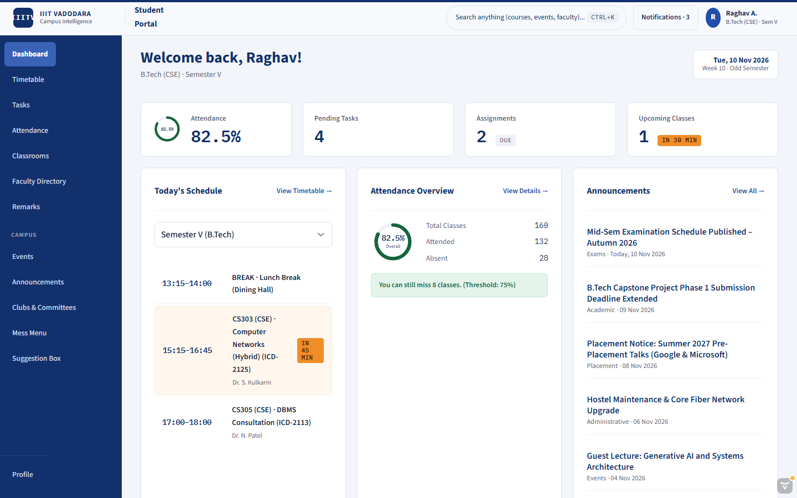

#### 2. Weekly Timetable (`/timetable`)
*Matrix grid view and day timeline with official ICD campus room numbers (e.g., ICD-2125, ICD-2113, ICD-2102-CS), interactive semester switcher (Sem I, III, V, VII, MCA), faculty tags, and print stylesheet.*
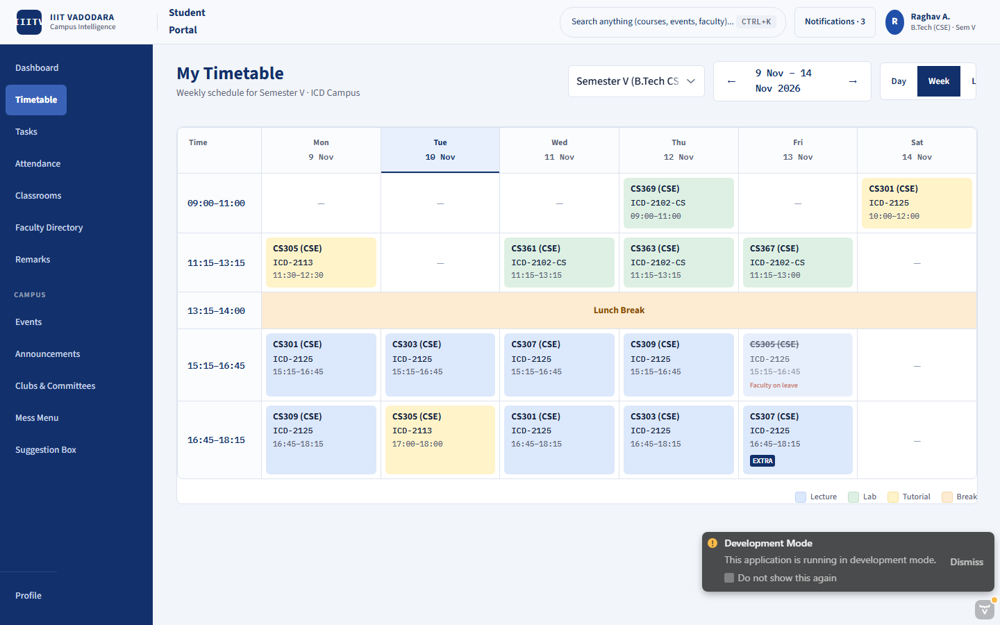

#### 3. Course Attendance Register (`/attendance`)
*Overall percentage gauge, course-wise breakdowns, Safe/Watch/Short chips, and weekly register.*
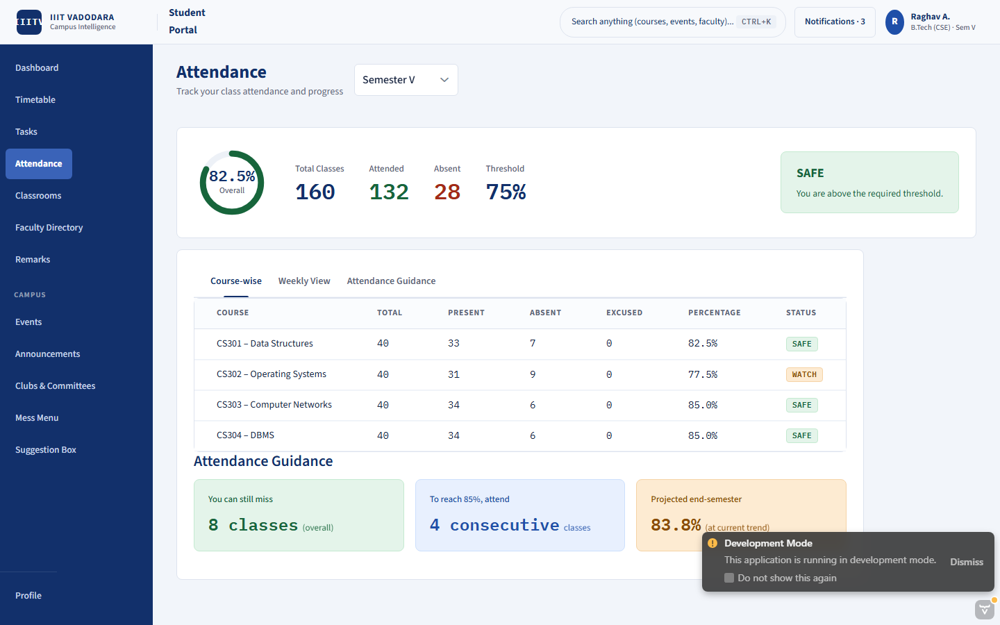

#### 4. Classrooms List (`/classrooms`)
*Course cards, term identifiers, instructor metadata, and quick Join Classroom modal.*
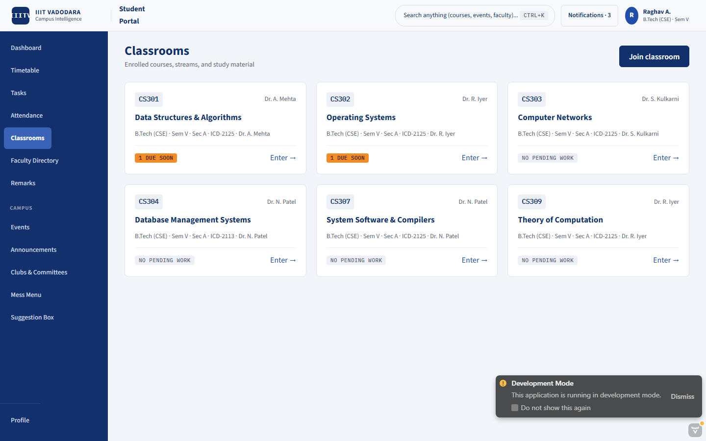

#### 5. Classroom Detail (`/classrooms/CS301`)
*Course hero banner, Stream posts, Classwork deliverables, and People directory.*
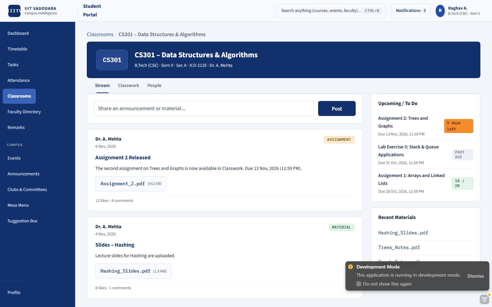

#### 6. Tasks & Deliverables (`/tasks`)
*Master-detail layout: Quick-add task bar, priority queue left, subtask breakdown and checklist right.*
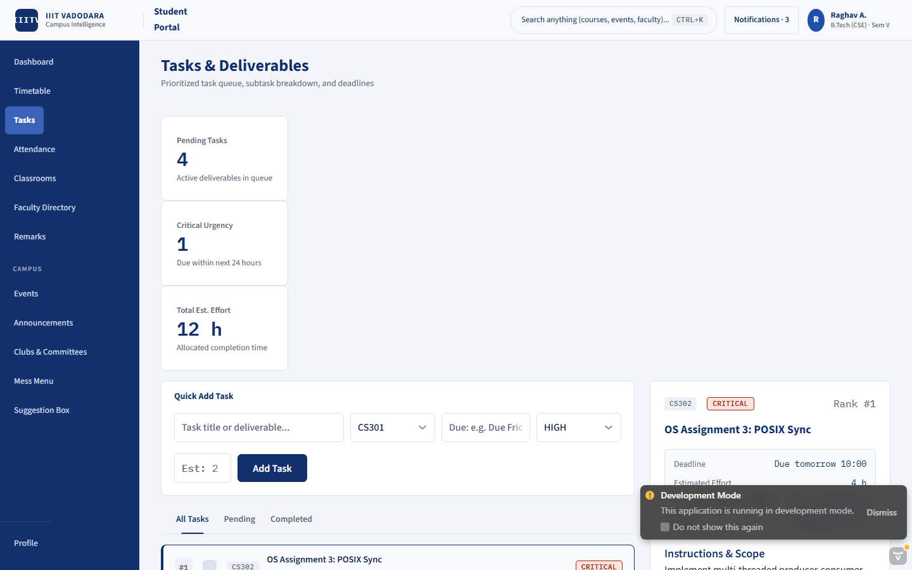

#### 7. Faculty Directory (`/faculty-directory`)
*Professor cards with department filters, office hours, live "In class until..." badges, and schedule.*
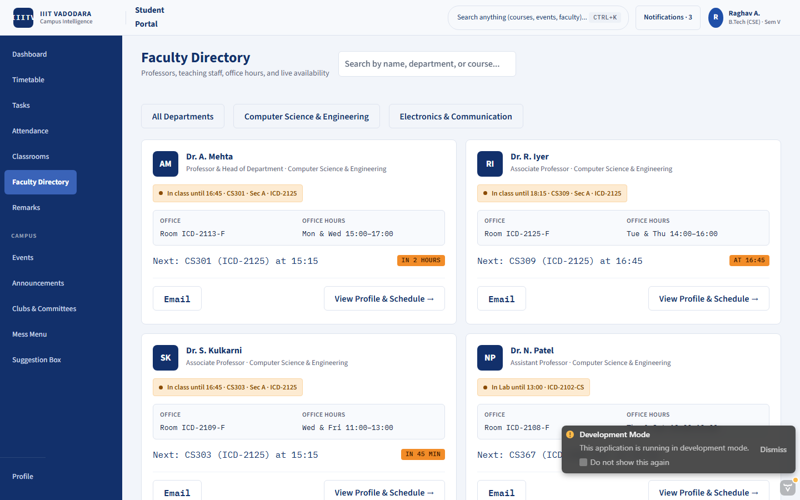

#### 8. Campus Events (`/events`)
*Today / This week / Next 30 days filters, schedule clash marker, RSVP actions, and venue details.*
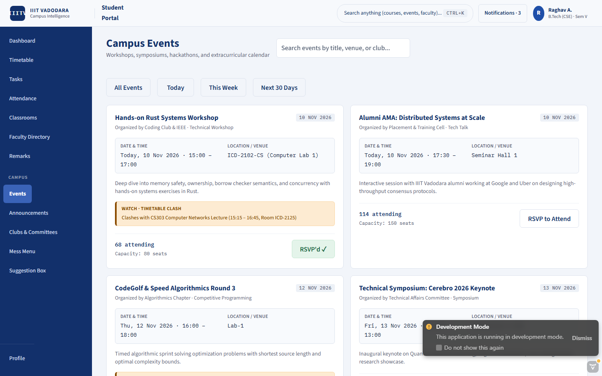

#### 9. Announcements (`/announcements`)
*Category chips (Academic, Placement, Hostel, Admin), unread indicators, and pinned notices.*
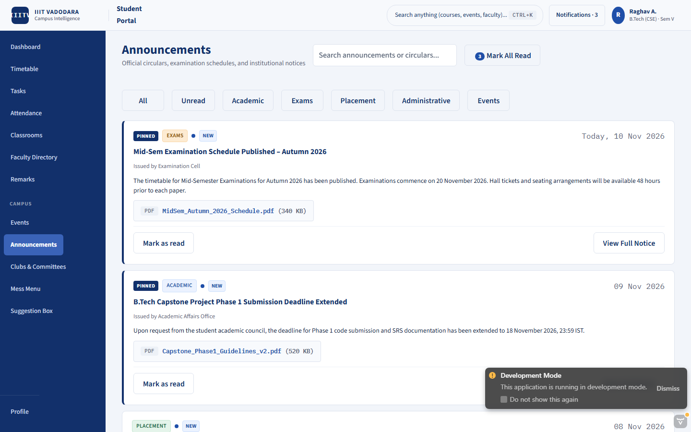

#### 10. Mess Menu & Feedback (`/mess-menu`)
*Today's meal strip with "Serving Now" badge, weekly breakfast-lunch-snacks-dinner matrix, and meal rating dialog.*
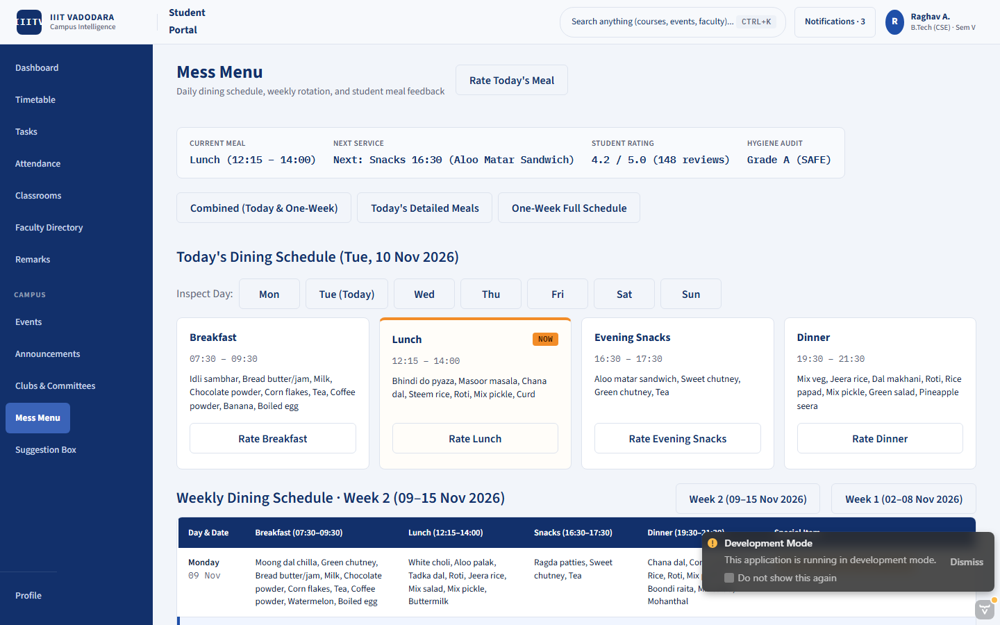

#### 11. Suggestion Box (`/suggestions`)
*Public campus board, upvote counts, category filters, and anonymous suggestion submission.*
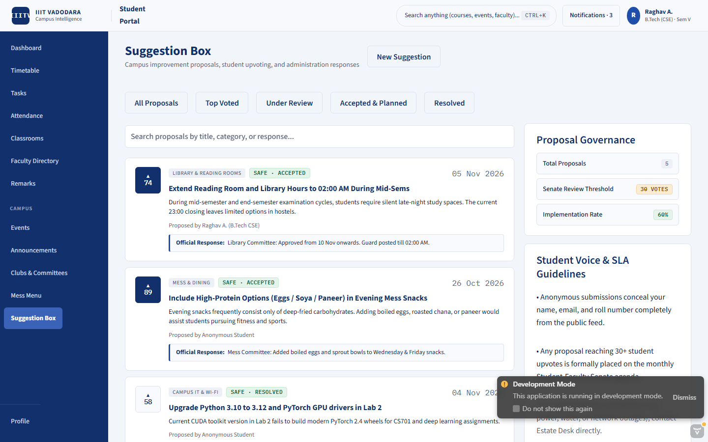

#### 12. Academic & Mentor Remarks (`/remarks`)
*Commendations, advisories, mentor feedback notes, and student acknowledgment actions.*
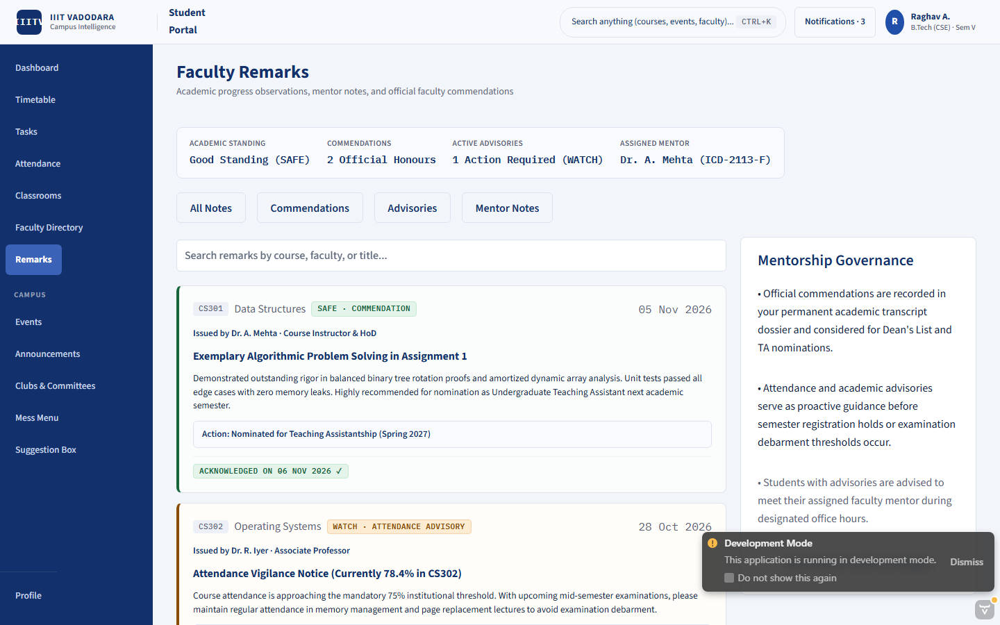

#### 13. Faculty Attendance Marker (`/faculty/attendance`)
*Live class roster, keyboard shortcuts (`P` for Present, `A` for Absent, `E` for Excused), and live counter strip.*
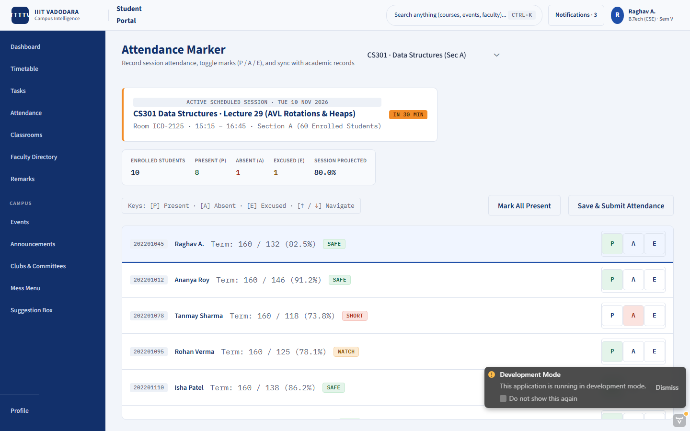

#### 14. Faculty Gradebook (`/faculty/gradebook`)
*Interactive grading grid with score input fields, max score validation, submission timestamps, and CSV export.*
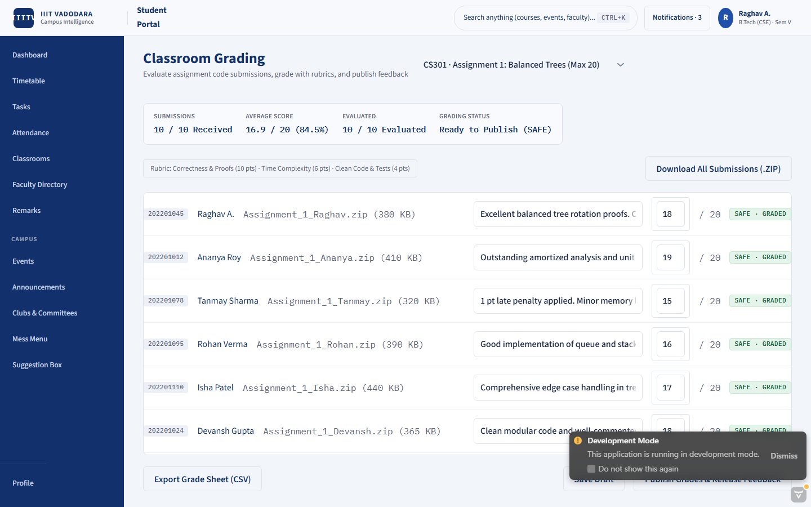

---

## Testing

### Karibu-Testing Unit Tests

Automated headless UI testing is implemented via **Karibu-Testing v24.1.8**. Tests verify route auto-discovery, view instantiation, and main UI states (**loading**, **empty**, **loaded**, and **error**).

```
src/test/java/com/iiitv/campus/ui/views/
├── BaseKaribuTest.java           # Setup with MockVaadin and View auto-discovery
├── DashboardViewTest.java        # Dashboard stats, timetable schedule, error simulation
├── TimetableViewTest.java        # Loaded timetable matrix, empty schedule, error states
├── AttendanceViewTest.java       # Attendance gauge, safe/short badges, empty register
├── ClassroomsViewTest.java       # Classroom cards, CS301 detail view, empty course state
├── TasksViewTest.java            # Ranked list, quick-add input, empty task queue
├── FacultyDirectoryViewTest.java # Faculty cards, search filtering, empty search state
├── EventsViewTest.java           # Timeframe filtering, RSVP toggle, empty events state
├── AnnouncementsViewTest.java    # Category chips, mark-all-read action, empty state
├── MessMenuViewTest.java         # Daily strip, weekly matrix, empty menu state
├── SuggestionBoxViewTest.java    # Upvoting, new suggestion modal, empty board state
├── RemarksViewTest.java          # Commendation/advisory cards, acknowledgment toggle
└── FacultyViewsTest.java         # Faculty attendance roster & gradebook scoring
```

Run unit tests:
```bash
mvn test
```
*Result: 28 tests run, 0 failures, 0 errors, 100% passing.*

### Playwright Smoke Tests

End-to-end smoke tests are configured via Playwright (`smoke-test.mjs`) to test real browser interactions:
- **Navigation Flow**: Login / Portal Entry $\rightarrow$ Dashboard $\rightarrow$ Timetable $\rightarrow$ Attendance $\rightarrow$ Classroom List $\rightarrow$ Classroom Detail (`CS301`).
- **Responsive Viewport Test**: Verifies zero horizontal overflow (`scrollWidth === clientWidth`) at 360px mobile width.
- **Visual Artifacts**: Captures high-resolution screenshots for all 14 views.

Run the Playwright smoke test:
```bash
node smoke-test.mjs
```

---

## Running the Application

### Prerequisites
- Java 21 JDK (`Amazon Corretto 21` or `OpenJDK 21`)
- Maven 3.9+
- Node.js 18+ (for Playwright testing)

### Run in Development Mode
```bash
mvn spring-boot:run
```
The application will be accessible at: `http://localhost:8080`.
